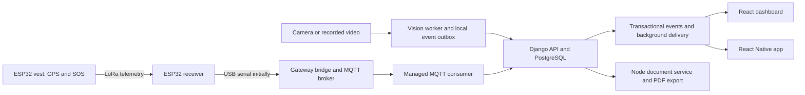

# Site-Safe completion plan for Claude

Prepared 13 October 2026. User constraints: no dedicated project hardware currently owned, economical budget, no fixed demonstration deadline, finish as soon as the project is genuinely complete. This document specifies future work; it does not claim that the phases below have been implemented.

## Mission and scope

Complete the existing Site-Safe project, retaining its Django/PostgreSQL backend, React dashboard, Node report service and Python vision pipeline. Deliver working, tested features plus the evidence, report and setup package needed for the FYP. Extend existing implementations instead of rebuilding them wholesale.

Default to the full scope in the report: PPE, fall/proximity/inactivity, QR identity, zones, worker activity, web/mobile alerts, GPS/SOS vest with LoRa, fire/smoke with hot-work policy, and incident/compliance reporting including PDF. The university's approved proposal remains the authority. Only the human team/supervisor can approve scope reductions. Do not silently move missing features to future work.

Read the [current audit](/Users/hamza/code/site-safe/docs/FYP_READINESS_REVIEW_2026-10-13.md), [earlier detailed audit](/Users/hamza/code/site-safe/docs/PROJECT_AUDIT_2026-09-20.md), [AI roadmap](/Users/hamza/code/site-safe/docs/AI_ACCURACY_ROADMAP.md) and [hardware plan](/Users/hamza/code/site-safe/docs/HARDWARE_AND_PURCHASE_PLAN.md). Older handoff/README statements about model training and fall detection are stale: recheck source and artifacts.

### Working rules

1. Preserve all existing working-tree changes. Record the baseline before editing; do not reset, clean or overwrite user changes. Use small coherent changes, reversible data migrations and focused tests.
2. Implement one reviewable work package at a time. Read its prerequisites, update the evidence ledger, and continue unblocked work without routine confirmation. Request human action only when it is genuinely needed: hardware, source footage, label adjudication, credentials/accounts, paid resources, or academic decisions.
3. Separate **coded**, **automated-tested**, **integration-tested**, **physically verified**, and **accepted**. Mocked GPS, synthetic camera frames and simulated push cannot satisfy a physical acceptance gate.
4. Keep tests proportional to risk. Existing 59 backend and 10 AI utility tests must continue passing, but add behavioral regression tests for new/changed contracts rather than tests that merely repeat implementation details.
5. No fabricated sensor values, evidence, signatures, Turnitin scores, accuracy figures or field-validation claims. Unknown/offline/unsupported must be visible.
6. Keep model/dataset versions and secrets separate from application code. Do not commit credentials, private worker video or large datasets. Retain reproducible manifests and retrieval instructions.
7. Public deployment, paid resources and external notifications to third parties require the user's authorization. Develop against local services, test recipients and isolated databases. Do not overwrite development records to make a test pass.
8. Avoid unnecessary infrastructure. Start with one site, one camera and one vest, but include independent multiple-person and device-identity tests. Remove misleading multi-site controls unless genuine multi-site support is agreed.

## Delivery architecture



This is a proposed target, not a diagram of the current complete system. USB reception on the existing computer avoids buying a Raspberry Pi. Raw point-to-point LoRa is the economical default, subject to the approved proposal accepting it; it must not be described as LoRaWAN. The existing computer runs the broker/bridge. Camera video travels over USB/IP, never LoRa.

## Dependencies and execution order

| Phase | Outcome | Prerequisites |
|---|---|---|
| 00 | Baseline, requirements and reproducible development | None |
| 01 | Secure identities, validated data and versioned contracts | 00 |
| 02 | Durable events, live updates and camera recovery | 01 |
| 03 | Honest dashboard, workers and operational settings | 01; live behavior uses 02 |
| 04 | Correct dataset, provenance and independent evaluation split | 00; start early |
| 05 | Person-level vision, QR identity and calibrated detectors | 01/02; model selection requires 04 |
| 06 | Spatial zones, presence, shifts and activity history | 03/05; GPS acceptance uses 07 |
| 07 | Real GPS/SOS vest and LoRa receiver | 01/02 plus purchased bench components |
| 08 | Mobile app and real notification delivery | 01/02/03; activity views use 06 |
| 09 | Fire/smoke and explicit hot-work policy | 02/04/05/06 |
| 10 | Correct historical analytics, DOCX and PDF reports | 02/03/06; include retained sources from 07/09 |
| 11 | Full-system validation, repeatable release and recovery | All retained feature phases |
| 12 | Accurate FYP report, presentation and submission package | Draft during all phases; finalize after 11 |

Recommended sequence for a single coding agent: 00 → 01 → 02 → 03 → 04 → 05 → 06 → 07 → 08 → 09 → 10 → 11 → 12. Start human data collection, equipment sourcing and scope/template confirmation during 00; do not wait until their implementation phase. If a human dependency blocks one phase, record it and work on another independent phase. Do not mark the blocked phase accepted.

Keep a working demonstration after each phase. No fixed calendar estimate is implied: label review, data acquisition, hardware delivery and measured model performance control the schedule more than code generation speed.

## Phase 00 — Establish the baseline and acceptance contract

**Tasks**

- Inventory code, migrations, model files, environments and existing edits; record commit plus working-tree state. Re-run the baseline tests and strict dataset audit. Preserve failures as known baseline issues.
- Install locked JavaScript dependencies, verify runtime compatibility from package manifests/lockfiles, and run frontend build/lint. Make Python dependencies reproducible without speculative major upgrades.
- Document PostgreSQL, Django/ASGI, frontend, report service and inference startup. Resolve local report-service URLs. Create sample environment files without credentials and an explicit demo-data command that cannot run accidentally against production.
- Create `docs/requirements_traceability.csv`: ID, original objective, requirement, priority, owner, phase, code/API, acceptance test, evidence path, status, scope decision. Translate all report commitments into rows, including hardware and mobile.
- Record decisions in `docs/architecture_decisions.md`: single-site baseline, timezone policy, identity sources, coordinate systems, event protocol, notification transport, PDF conversion, radio protocol and deployment target.
- Ask the team for the approved proposal and applicable Lahore report template. Continue technical work while those are pending; do not claim that a scope amendment has already happened.
- Record initial benchmark on the development computer: model load, RAM, per-model inference latency, processed FPS and resource use for one representative stream. Add configurable compute-device selection if missing; do not assume current inference automatically uses the Mac GPU.

**Deliverables:** setup instructions, baseline evidence, requirement matrix, decision log, documented blockers and provisional NFR targets.

**Gate:** another person can start the existing core services from the instructions; test/build status and all known baseline failures are recorded. Every original objective has a traceability row.

## Phase 01 — Secure access and define data contracts

**Primary areas:** `backend/accounts`, `backend/alerts`, `backend/workers`, `backend/sitemap`, `backend/sitesafe`, frontend API/auth code, `ai-module/inference.py`.

**Tasks**

- Replace embedded administrator credentials with scoped device/service authentication. Decide token/key rotation and revocation; do not give cameras human administrator privileges.
- Protect alert/detection/telemetry writes and WebSocket subscription; enforce allowed origins and role permissions. Make frontend/mobile token refresh single-flight, bounded and logout-safe.
- Define a versioned ingestion envelope: event ID, device/camera ID, event kind, observed time, received time, source/session/track, optional worker, confidence/evidence references, model/config version, and simulation flag. Allow unknown identity honestly.
- Validate confidence, normalized or explicitly typed boxes, GPS ranges/fix quality, battery units/range, booleans, timestamps, camera IDs and polygons. Keep geographic polygons and image-coordinate polygons in distinct schemas.
- Resolve `Worker.vest_id` versus `SmartVest.worker/vest_id` with migration/backfill and conflict reporting. Preserve history across reassignment and deactivation; prefer logical deactivation where deletion would destroy evidence.
- Add camera/device registry and ownership/authorization fields needed by later phases, without building an unnecessary multi-tenant platform.

**Acceptance tests:** anonymous/incorrect-role/other-device actions fail; valid producers work; revoked credentials fail; malformed payloads cannot change state; expired clients refresh/recover; migration preserves existing legitimate assignments and flags conflicts.

**Gate:** shared contract documented, all active producers use authorized validated paths, and auth/validation tests pass against PostgreSQL as well as applicable unit fixtures.

## Phase 02 — Durable delivery, consistent live state and recovery

**Tasks**

- Split inference capture/detection from HTTP delivery. Use a durable local outbox with stable event IDs, bounded storage policy, retries/backoff and acknowledgement. Persist an event before consuming its one-shot latch; delivery failure must not silently exhaust a cooldown.
- Enforce backend idempotency with a unique producer/event key. Store server receipt separately from source observation time. Define clock-skew behavior and deduplication retention.
- Introduce transactional backend event records and a retrying dispatcher. Database save followed by an in-process send alone is not a crash-safe outbox.
- Broadcast create/update/resolve, worker/vest/device status and rule changes from all paths, including MQTT. Use a shared Channels layer for multiple processes and reconcile authoritative state after reconnect.
- Run MQTT ingestion and delivery workers as supervised processes, not accidental duplicate startup threads in Django web workers. Implement broker authentication and topic restrictions.
- Queue notification work with retries so provider failure does not roll back a persisted incident. Use test recipients while developing.
- Add camera reopen/backoff, distinguish video EOF from stream loss, health heartbeats and stale-frame detection. Reset uncertain temporal state across observation gaps; keep capture latency bounded.
- Record immutable resolution/review actions with actor/time/reason; do not overwrite the original observation.

**Acceptance:** introduce API outage, expired token, duplicate event, broker restart, worker crash and WebSocket disconnect. Confirm one persisted incident per event, independent capture progress, eventual delivery within the declared retention window, and consistent state in two dashboard sessions.

**Gate:** saved incidents survive restarts; failure states and queue depth are visible; no lost events in the defined bounded outage fixture. Document what happens if storage fills or an outage exceeds retention.

## Phase 03 — Complete the web application and effective settings

**Tasks**

- Implement worker create/edit/deactivate and vest assignment workflows with validation and role-aware controls.
- Replace pseudo-vitals, fabricated last-seen values, preset trend series and fixed KPI deltas. Use observed timestamps and actual aggregates; show “not measured” for unsupported sensors.
- Separate active employment/registration from observed presence and device connectivity. Mark stale data explicitly and handle empty datasets without invented percentages.
- Wire enabled flags, persistence thresholds, notification choices and zone overrides to runtime policy. Define rule precedence/versioning and seed sensible editable defaults.
- Correct FALL filters and simulation choices, logged-in user/role labels, unsupported site selection, error/loading/empty states and socket reconnect reconciliation.
- Distinguish simulated incidents in UI, aggregates and export filters. Default analytical claims to real evidence.

**Acceptance:** complete worker registration → assignment → observation → incident → resolve from the UI; viewer cannot mutate; changing a rule visibly changes behavior; all displayed numerical values reconcile to a fixture.

**Gate:** browser acceptance flow works, frontend builds/lints, and all visible controls have implemented behavior. Preliminary counts can be useful before phase 10; label them accurately.

## Phase 04 — Repair the datasets and protect evaluation

**Tasks**

- Preserve the original dataset and generate immutable manifests. Retain provenance, license/consent, source video/session/camera/site metadata and augmentation ancestry.
- Extend the current split planner into a materializer driven by reviewed decisions. Human review resolves contradictory labels; do not auto-invent labels to make the audit pass.
- Review the 69 conflict groups and rare classes; group duplicate/near-duplicate/source siblings before splitting; validate class maps and pairing; add real backgrounds and difficult negatives.
- Collect target-camera footage with controlled distance, pose, lighting, occlusion and crowding. Annotation and privacy review are human responsibilities even when Claude provides tools.
- Seal a genuinely untouched final evaluation set, with session/site grouping. Keep validation separate for model and threshold selection. Keep dataset copies/hashes and decisions reproducible.
- Define video-event annotation schema: interval, type, person/track, visibility, expected alert, matching/tolerance rules and reviewer notes. Collect independent fall/proximity/inactivity examples and fire/smoke data for later work.
- Use suitable prerecorded footage for falls and dangerous vehicle-proximity events; do not stage hazardous incidents to collect positive examples.

**Deliverables:** reviewed materialization decisions, new dataset version, strict audit report, label guidelines, source inventory, locked evaluation protocol and pilot sample-size plan.

**Gate:** no known duplicate/source leakage or unresolved label conflicts; final test remains unused for tuning. If source metadata cannot be recovered, document the uncertainty and collect a separate target-camera test set rather than claiming independence.

## Phase 05 — Person-level vision, worker identification and calibration

**Tasks**

- Introduce stable camera-session track IDs and associate head/torso/hand/foot PPE evidence to each person. Handle overlapping people and conflicting detections.
- Represent present/absent/not-observable; use observed-time or K-of-N persistence, hysteresis and per-person cooldown. Never infer “missing” solely from an unobserved body region.
- Implement QR issuance, revocation/reissue, printing, decoding and track association. QR content should be an opaque reference, not worker personal data. Bound identity confidence/lifetime; unreadable or ambiguous scans remain unknown. A copied QR is an identification limitation, not strong proof of person identity.
- Use checkpoint-based QR association initially; measure readable size/distance/angle. Do not promise identity tracking across all cameras after a single distant helmet scan.
- Strengthen fall/inactivity association, posture uncertainty and gap handling. Track proximity by person/vehicle pair; only claim physical distance after calibration.
- Preserve existing ten-class and pose implementations as baselines. Train on phase-04 data, compare controlled experiments and calibrate per-class temporal/confidence settings on validation. Do not upgrade to a newly advertised model family without evidence that the change helps.
- Save model checksums, actual completed epochs, package/runtime versions, dataset hashes, per-class metrics and raw evaluation output. Select the deployment model using both violation performance and hardware throughput.
- Save event evidence under authenticated access with a defined retention policy.

**Acceptance:** independent same-class violations from multiple people; brief false detections; occluded body parts; contradictory evidence; QR swap/unreadable/revoked code; track loss/re-entry; normal kneeling/bending; stale frames; different vehicle pairs.

**Gate:** calibration protocol and video results support each enabled class within a stated operating envelope. Weak classes stay visibly limited until improved or formally removed from scope. QR acceptance requires physical camera testing, not generated QR unit fixtures alone.

## Phase 06 — Zones, location, presence and workforce activity

**Tasks**

- Build geographic map/polygon editing for GPS and camera ROI editing for image-plane zones. Keep coordinates explicit; linking a camera to a zone does not establish a boundary crossing.
- Define restricted-zone permissions, entry/exit hysteresis/dwell and overlap priorities. Generate both anonymous camera breach events and worker-linked events when identity is trustworthy.
- Use GNSS fix age/quality and boundary uncertainty; do not infer precise indoor position from GPS. Keep assigned zone separate from observed location.
- Generate idempotent ActivityLog transitions for check-in/out, zone entry/exit and idle start/end, with source and confidence. Define shift boundaries/timezone, overnight shifts and duplicate/out-of-order handling.
- Distinguish observed inactivity from an authorized break and from lack of visibility. Provide correction/review history rather than silently changing records.
- Add observed occupancy and attendance/activity history screens. Preserve historical worker-zone relationships for reporting.

**Acceptance:** boundary jitter, stale GPS, overlapping zones, camera occlusion, unknown QR, reassigned vest, two workers crossing, overnight shift and reordered events. Replay produces the same activity history without duplicate transitions.

**Gate:** zone and activity histories reconcile with independently annotated scenarios; physical GPS checks are linked from phase 07.

## Phase 07 — Build and integrate one real GPS/SOS vest

**Human inputs:** buy/borrow the phase-A/B components in the hardware plan; provide exact board revision, radio band/module and GNSS breakout documentation. Claude must not invent a wiring pinout before those are known.

**Tasks**

- Add versioned `firmware/vest`, `firmware/receiver` and gateway-bridge projects with pinned toolchain/library versions and flashing instructions. Existing MQTT handlers are scaffolding to finish, not a running gateway.
- Bring up each component independently: serial heartbeat, GNSS fix/age, debounced SOS button and real battery measurement if supported. Missing battery telemetry stays unknown.
- Define compact packets containing protocol version, device/boot ID, monotonic sequence, event kind, observation time or uptime, fix state/position and measurement status. Use authenticated messages/replay protection with maintained cryptographic primitives and per-device keys; do not design new cryptography.
- Implement bounded retries, duplicate suppression and SOS acknowledgement. Differentiate radio receipt, backend persistence and human acknowledgement; a radio ACK must not claim that help has arrived.
- Implement receiver → USB bridge → authenticated broker → supervised consumer → common ingestion/event path. Capture sequence, packet reception and broker/backend health for debugging.
- Add offline timeout, firmware identity, provisioning/revocation and reassignment behavior. Keep GPS validity and message timestamp distinct.
- Finalize wiring, enclosure, strain relief and power only after bench stability. Measure current, battery runtime, packet loss and end-to-end SOS delay under the tested conditions.

**Physical gate:** one assembled vest sends actual GNSS readings and button-generated SOS over the actual LoRa link; API records one event; web/mobile show it; unplug/reconnect and duplicate-packet tests pass; location loss shows unknown. Retain photos, firmware hash, measured results and wiring revision. Simulator results cannot close this gate.

## Phase 08 — React Native mobile app and notification delivery

**Tasks**

- Add `mobile/` using a supported React Native setup chosen against the project's actual notification/native requirements. Share documented API contracts; do not duplicate business rules on the device.
- Implement secure login/refresh/logout, role-aware alert list/detail/acknowledge/resolve, worker/zone status and authorized rule management. Clarify acknowledgement versus resolution semantics.
- Register/revoke push tokens; handle notification permission, foreground/background delivery and navigation to a fetched authorized incident. Avoid sensitive payloads on lock screens.
- Implement the advertised email preference using a configured provider and authorized test inbox, with the same recipient/rule and retry policy; otherwise obtain an explicit scope decision and remove the unsupported control. Never report an email as delivered merely because it entered a queue.
- Handle unreliable connections, cached/read-only states, retry/reconciliation and expired sessions. Follow device LAN URLs; `localhost` on a phone is not the developer laptop.
- Build Android first for economical physical verification; maintain cross-platform code and test iOS if the cross-platform objective is retained. Record signing/build prerequisites instead of pretending Android testing establishes iOS support.

**Gate:** installed Android build receives and opens a real test notification, reflects rule/preferences changes, and resolves an incident visible on web. Provide iOS build/test evidence for any delivered iOS claim. Provider outages must not prevent incident storage.

## Phase 09 — Fire/smoke detection and hot-work policy

**Tasks**

- Add versioned fire/smoke data/model evaluation under the same provenance and split rules as PPE. Include steam, dust, reflections, welding and compression/lighting negatives.
- Extend alert types and migrations consistently through API, web, mobile, notification and report code.
- Implement hot-work permits with zone/ROI, time window, authorized creator/approver, status and audit trail. Preserve detected evidence and policy decisions.
- Define when expected hot-work observations are downgraded/routed rather than discarded. Unauthorized/out-of-zone/expired permits cannot suppress alerts; define an override for persistent/escalating evidence.
- Allocate inference cadence within the measured compute budget; adding a fourth model must not silently make other alerts stale.

**Gate:** labeled safe video fixtures cover fire, smoke, hard negatives and all permit boundaries; traceable events reach both clients/reports; held-out results and remaining limitations are reported. Use licensed recordings for fire cases; do not create a fire or smoke exposure for demonstration.

## Phase 10 — Defensible analytics and document reports

**Tasks**

- Define metric contracts before charts: incident counts, observed-worker time, response time and any compliance denominator. A lack of alerts is not evidence of compliance. Unknown/unobserved intervals are excluded or reported explicitly.
- Compute historical aggregates from event-time data and historical assignment/context, not current worker/zone membership. Keep global and worker-linked camera events distinguishable.
- Repair the upstream-close/error-body bug, strict date validation, pagination, truncation, timezone boundaries and interrupted-download behavior. Generate from a consistent data snapshot; distinguish queued/running/failed/completed report jobs.
- Produce both DOCX and PDF when required. Select and document a bounded conversion path; verify fonts, pagination and output validity. Do not convert by renaming extensions.
- Include filters, date range, data completeness, simulation inclusion, metric definitions and model/evaluation limitations. Apply the same permissions to generation, history and saved downloads.

**Gate:** fixed fixtures including zero data, unknown identity, resolved/unresolved events, date edges, reassignment, more than one API page and more than one output page reconcile exactly. Open both generated formats and inspect them visually. Reports remain valid after a service failure/retry.

## Phase 11 — Full-system validation and repeatable release

**Tasks**

- Add CI for the meaningful Python suites, PostgreSQL integration/migration checks, frontend lint/build and critical browser flows, report service and contract checks. Heavy model evaluation runs separately with versioned artifacts.
- Validate unauthorized access, evidence-download permissions, token/device revocation and socket isolation. Run selected outage/crash/replay scenarios across the assembled system.
- Evaluate the sealed datasets once the model/rules are locked. Retain full results, sample counts and failure examples. If results lead to further tuning, the set becomes development evidence and a new independent final set is needed.
- Measure throughput, event delay, memory, queue growth, recovery and device battery/radio behavior on the actual demo hardware. Test all enabled models together, not just isolated model FPS.
- Add repeatable service startup, health checks, supervised workers, structured logs, dependency/model retrieval and checksums. Infrastructure may be containerized while Mac camera inference remains native if that is simpler.
- Verify media access, backup/restore and fresh-machine installation. Stage a reproducible demo dataset separately from real measurements.
- Fix README/version drift and document troubleshooting: no camera, stale GPS, expired token, missing model, unavailable broker/report service, failed push and QR unreadability.

**Gate:** every retained requirement has acceptance evidence; no unresolved critical correctness/security defect; a clean installation and restore exercise succeed. A feature that fails its acceptance target stays open, even if its code is complete.

## Phase 12 — FYP report, presentation and final package

**Tasks**

- Maintain SRS, architecture and test notes as implementation proceeds. After phase 11, freeze the release and reconcile every report claim against that version.
- Confirm the department's applicable outline/formatting; the supplied guides conflict. Add measurable FR/NFRs, requirement traceability, detailed use cases and relevant class/DFD/activity/sequence/component/deployment diagrams.
- Update all model and fall statements, class counts, abstract, scope, implementation, tables, limitations and conclusion consistently. State independent versus contaminated historical evaluation accurately.
- Add requirement-linked test cases with environment, inputs, steps, expected/actual outcomes, evidence, dates and tester. Explain model/event metrics and sample limitations.
- Prepare genuine approval/declaration/plagiarism/Turnitin pages, contribution records and meeting-log references. The team obtains signatures, supervisor acceptance and Turnitin output.
- Apply selected word-count, heading, caption and numbering rules; regenerate contents/lists; verify citations. Make report generation reproducible and inspect rendered pages.
- Build a concise defense deck, timed demo script, fallback recording, setup/user manuals and source/model/firmware release manifest. Package required electronic and hardcopy submissions according to current department instructions.

**Gate:** supervisor accepts the scope/evidence/report; required administrative documents are authentic and complete; demo rehearsal and final package match the frozen release. Claude can prepare the artifacts, but cannot confer academic approval.

## Proposed acceptance targets to finalize in phase 00

These are engineering starting points, not university rules or already measured results. Adjust explicitly to the selected hardware/use case before using them as acceptance criteria.

| Concern | Starting target and measurement |
|---|---|
| Stored event to web update | p95 ≤2 seconds on the declared local network, measured from backend commit; exclude detector persistence and report that separately. |
| Recovery fixture | Queue 100 events during a 5-minute API outage; all survive sender restart and appear once within 60 seconds of restored healthy service under the declared load. |
| Source/event timing | Report p50/p95 capture-to-confirmation and confirmation-to-display separately; include known dwell settings and clock uncertainty. |
| Authorization | Every documented forbidden role/device/socket action is rejected; every permitted counterpart has a positive test. |
| Reports | Exact fixture reconciliation, correct unknown/empty states, no silent row loss or unsupported percentages. |
| QR | Define minimum printed size, lighting, angle and distance; measure correct association, unknown and wrong-person rates on that envelope before accepting. |
| AI events | Initial planning targets: precision ≥90%, episode recall ≥85%, ≤1 false alert/camera-hour **per retained alert type** in its declared conditions; refine with supervisor. Include confidence intervals and sample counts; these are not a safety certification. |
| Evaluation pilot | Start with at least 30 independent positive episodes per event type and 10 negative camera-hours per suite as a data-collection planning floor; this is not sufficient by itself for strong generalization claims. Increase based on uncertainty and coverage. |
| Hardware | Record actual SOS delivery success/delay, packet-loss/range conditions, GPS validity and measured runtime; agree acceptable values after the first bench prototype. |
| Soak | At least a 2-hour full-stack demo rehearsal with queue/memory/health observation and a controlled disconnect; longer field claims require longer evidence. |

Do not improve a reported score by excluding hard cases after seeing test outcomes. Record unknown identity/visibility separately from detection misses and report coverage as well as quality.

## Ownership: Claude versus human team

| Claude can produce/execute when the environment supports it | Human team must supply or perform |
|---|---|
| Code, migrations, tests, firmware, data tools, training scripts, builds, diagrams, manuals, draft report | Approved scope/template, hardware procurement/assembly, camera setup, authentic records/signatures |
| Automated labeling assistance and annotation review queues | Ground-truth adjudication, authorized footage collection, difficult-case review |
| Model training/evaluation with available compute and data | GPU/account access if needed; approve any paid usage; judge deployment goals |
| Device firmware and diagnostic scripts | Flash/measure/inspect physical boards if no connected access; verify battery/radio/GPS behavior |
| Mobile builds and test procedures | Physical device access, notification accounts/signing, iOS evidence if retained |

## Progress ledger and phase handoff

All execution phases start **not started under this plan**; existing code is the baseline, not proof that a phase gate is complete. At each handoff, append:

```text
Phase / task IDs:
Status: not started | in progress | coded | tested | awaiting human evidence | accepted
Requirement IDs covered:
Commit / working-tree reference:
Files changed and migration notes:
Tests run, commands, date and outcomes:
Evidence artifact paths (exclude secrets):
Known defects / limitations:
Human inputs still needed:
Next independent task:
```

Do not use an overall percentage until requirements have agreed weights. Thereafter, calculate it from accepted weighted requirements and publish the denominator; report coded-but-unverified work separately.
