# Site-Safe User Manual

Site-Safe watches a construction site through cameras and smart vests, raises safety alerts as they happen, and keeps the record for follow-up and reporting. This manual is for the people who use it: site managers, safety officers and supervisors. Installation is in the [README](../README.md); a demonstration walk-through is in [DEMO_SCRIPT.md](DEMO_SCRIPT.md).

The screenshots were taken from a demo site built with `python manage.py setup_demo`. They show a test video playing as camera CAM-01, the vest simulator, and fictional workers. Simulated vest alerts are labelled as such.

## Contents

1. [Roles and signing in](#1-roles-and-signing-in)
2. [Dashboard](#2-dashboard)
3. [Alerts and incidents](#3-alerts-and-incidents)
4. [Cameras and danger areas](#4-cameras-and-danger-areas)
5. [Zones, the site map and hot-work permits](#5-zones-the-site-map-and-hot-work-permits)
6. [Workers, badges and vests](#6-workers-badges-and-vests)
7. [Reports](#7-reports)
8. [Settings](#8-settings)
9. [Mobile app](#9-mobile-app)
10. [Privacy and records](#10-privacy-and-records)
11. [Troubleshooting](#11-troubleshooting)

## 1. Roles and signing in

Open the dashboard address you were given and sign in with your email and password. The app on a phone asks for the same, plus the server address (for example `192.168.1.20:8000`).

| You can… | Viewer | Safety Officer | Admin |
|---|:---:|:---:|:---:|
| See the dashboard, alerts, workers, zones and site map | ✓ | ✓ | ✓ |
| See camera status and people counts on the map | ✓ | ✓ | ✓ |
| Watch live camera pictures | | ✓ | ✓ |
| Resolve alerts, export the incident log | | ✓ | ✓ |
| Register workers and vests, print QR badges, issue hot-work permits | | ✓ | ✓ |
| Generate and download reports | | ✓ | ✓ |
| Draw zones and danger areas, place cameras on the map, change alert rules | | | ✓ |

Accounts are created by an Admin in the administration site (`/admin/`), where the role is set. Sessions renew themselves; if you are signed out, sign in again. The account menu at the top right holds your profile, password, notification settings and **Sign out**. On a phone or narrow window, the menu button at the top left opens the navigation.

## 2. Dashboard

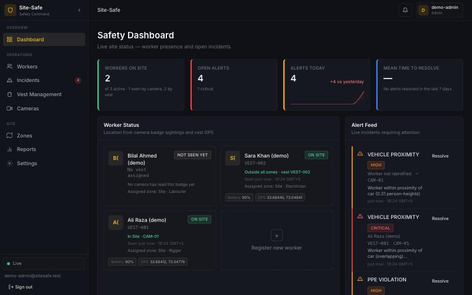

- **Top row:** workers on site (a camera read their badge in the last minute, or their vest is online), open alerts, alerts today against yesterday, and the mean time to resolve an alert.
- **Worker Status:** one card per worker with where they were last seen ("In Site · CAM-01", "Outside all zones · vest VEST-002"), vest battery and GPS, and a badge that turns red for an SOS.
- **Alert Feed:** open alerts, newest first, arriving live. Resolve one from here (Safety Officers and Admins).
- **Site Map** (scroll down): zones with live head counts, vests, and cameras with what they cover.

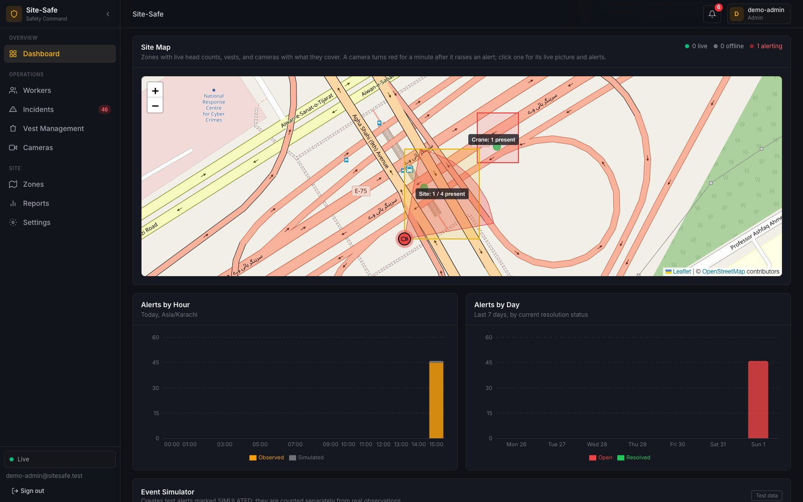

On the site map:

- A **camera** is green while its live view is current, grey with a dashed cone when offline, and red and pulsing for a minute after it raises an alert. Hover to see how many people it sees; click for its picture, alerts and a link to its live view.
- A **zone** is coloured by risk (blue low, yellow medium, orange high, red restricted) and labelled with its head count, for example "Site: 2 / 4 present".
- A **vest** is a dot: green online, grey offline, red during an SOS or while its gas reading is over the limit.

The **Event Simulator** at the bottom (Safety Officers and Admins) raises test alerts marked SIMULATED, for training. They are kept out of every report figure.

## 3. Alerts and incidents

### What raises an alert

| Alert | Raised when | Raised again for the same person only after |
|---|---|---|
| PPE violation | a camera sees a missing helmet, vest, gloves, goggles or boots on a person for 1 s | that item has been unseen on them for 30 s |
| Vehicle proximity | a person is within about one person-height of a car, truck, bus or motorbike | 15 s away from every vehicle |
| Danger area | a person's feet stay inside a danger area drawn on a camera picture for 1 s | 10 s outside it |
| Fall | a camera sees a collapsed posture for 3 s | the posture clears |
| Inactivity | a person has not moved for the inactivity time (5 min by default) | they move again |
| Fire / smoke | seen for 2 s (lower severity inside a zone with a hot-work permit) | the scene has been clear for 30 s |
| Zone breach | a worker enters a restricted zone they are not assigned to; a restricted zone's camera sees someone without a readable badge for 10 s; or a zone goes over its capacity for 10 s | they leave (for someone unidentified, 10 s out of the camera's view), or the zone is back within capacity for 60 s |
| SOS | a vest's SOS button is pressed | the SOS is cleared |
| Gas | a vest's gas sensor reads 2,000 ppm or more (flammable gas such as LPG or methane) | the level has been below that for 1 min |

A camera that reads a worker's QR badge names them on the alert; otherwise it says "Worker not identified". Camera alerts carry the **evidence frame** (the picture at that moment) and the **model version** that detected it.

### Incident log

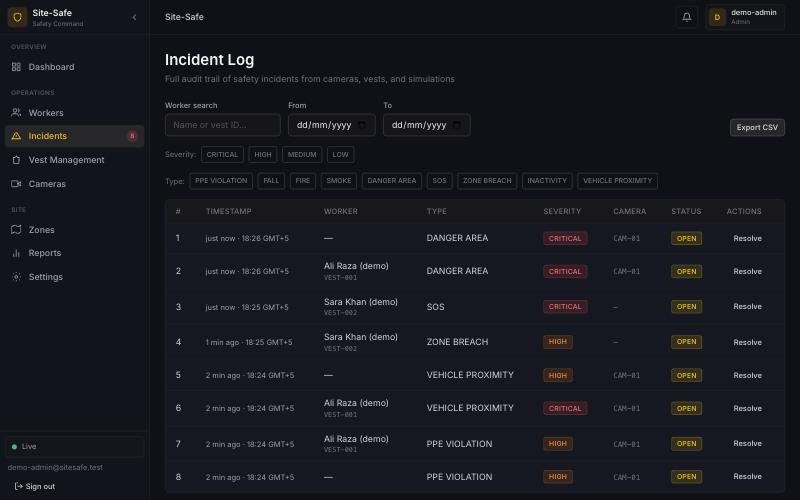

**Incidents** lists every alert. Filter by status (all, open or resolved), worker, date range, severity and type, and use **Export CSV** for the filtered list. The bell at the top and the Open Alerts figure on the dashboard open this page filtered to open alerts. Click a row for its details and evidence frame, and **Resolve** it once it has been dealt with. Resolving updates every open dashboard and phone at once.

## 4. Cameras and danger areas

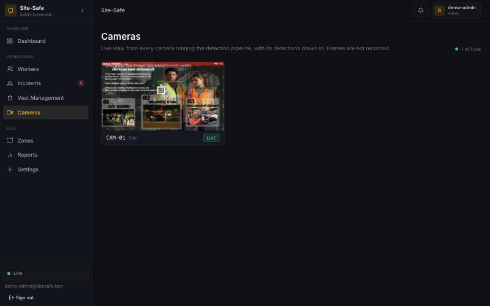

**Cameras** (Safety Officers and Admins) shows every camera's live picture, up to five frames a second, with what it detects drawn in. A camera that has sent nothing for 5 s shows as offline with the time of its last picture. Click a picture to enlarge it; the address (`/cameras?camera=CAM-01`) can be shared to open that camera directly. Pictures are relayed, never recorded.

### Drawing a danger area (Admins)

A danger area marks a hazardous part of one camera's view, such as a crane's swing radius, an excavation edge or a loading bay.

1. Open the camera and choose **Draw a danger area**.
2. Click the picture to add the corners, at least three. Draw where people **stand**: the system checks a person's feet, so an area drawn on a wall above the floor catches nobody.
3. Enter a name and a severity (Critical, High or Medium), then **Save area**. Use **Undo point** to remove the last corner.

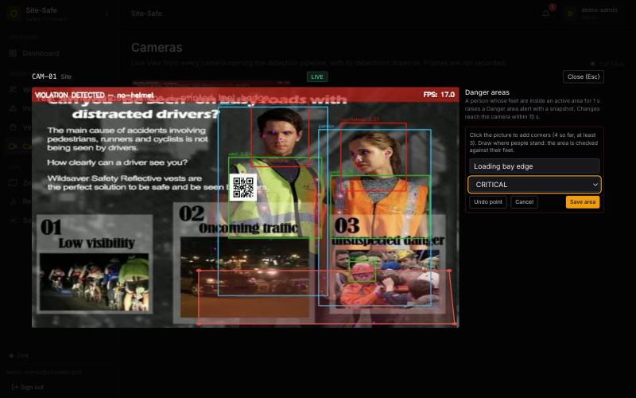

The camera picks up the area within 15 s. From then on it fills the area red while someone is inside and shows a "DANGER AREA" banner, and raises a Danger area alert after 1 s inside:

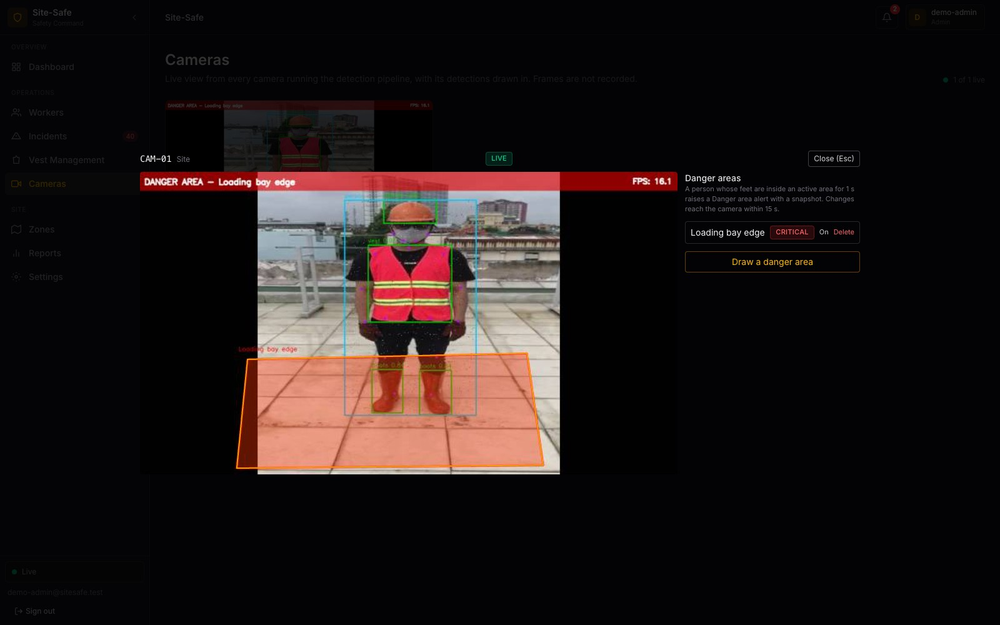

Next to each area, **On/Off** switches it off while the hazard is absent (for example while the crane is parked), and **Delete** removes it. Safety Officers see the areas but cannot change them.

## 5. Zones, the site map and hot-work permits

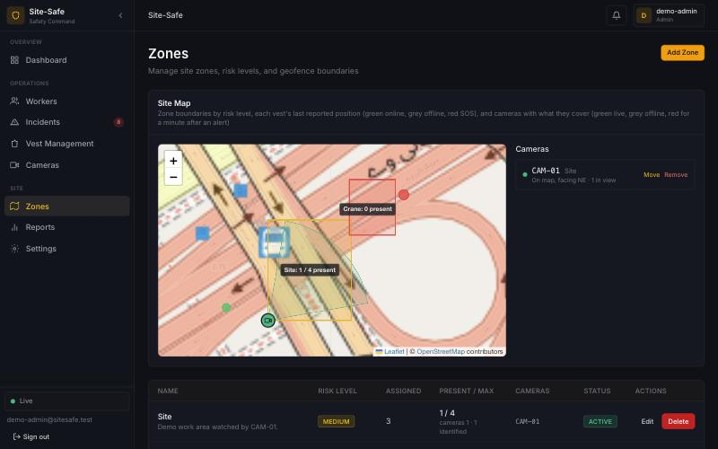

**Zones** shows the site map and the zone list.

**Adding or editing a zone (Admins):** choose **Add zone** or **Edit** and set:

- **Name** and **Description**.
- **Risk Level:** low, medium, high or restricted. A restricted zone raises a breach when a worker not assigned to it enters, and its cameras raise one, with the picture, for anyone they see for 10 s without being able to read a badge. Ask everyone allowed in to wear their badge where the camera can see it.
- **Max Occupancy:** the head count that raises an over-capacity alert (0 means unlimited).
- **Camera IDs:** the cameras that watch the zone. A camera belongs to one zone. A worker whose badge a camera reads is placed in that camera's zone.
- **These cameras can see the same people:** on, the head count is the largest single camera's count, so nobody is counted twice; off, the counts are added.
- **Boundary:** click the map to add corners, for vest GPS. A camera-only zone needs no boundary.

**Placing a camera on the map (Admins):** in the **Cameras** list next to the map, choose **Place** (or **Move**) and click where the camera is mounted. Turn it with **Facing**, and set its **View angle** and **Range**; the cone follows on the map. **Save position**. **Remove** takes a camera off the map without affecting its alerts or live view. The cone is what you enter, not measured from the picture.

**Hot-work permits (Safety Officers and Admins):** under **Hot-Work Permits**, choose a zone, describe the work (for example "Welding level 3 beams") and set **From** and **Until** (at most 12 h). Fire and smoke seen in that zone while the permit is active are still recorded and shown, at lower severity and linked to the permit. **Revoke** ends a permit early. A permit never hides fire.

## 6. Workers, badges and vests

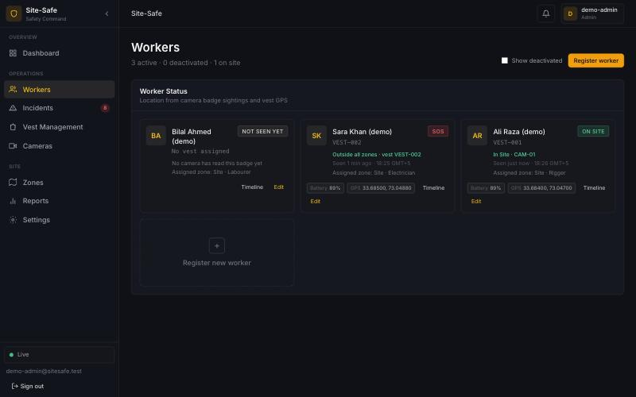

**Workers** shows each worker's presence and last known location. **Register worker** (Safety Officers and Admins) asks for full name, trade or role, phone, assigned zone and an optional smart vest.

**QR badges.** Open a worker with **Edit** and choose **Print badge**. Print it at least 8 cm wide and wear it on the chest or helmet, facing the cameras. The badge holds a random code, no personal data. **Reissue** makes a new badge and stops every earlier print working, for a lost badge.

**Timeline** shows a worker's day: when they were first and last seen, time on site, idle time and the zones they visited, from badge sightings and vest reports.

**Vest Management** lists vests with battery, gas level, last report and position. A gas level over the alert limit is shown in red. The gas sensor needs a minute to warm up after the vest is switched on, and must be switched on in clean air; until then no gas level is shown. Its reading is an estimate for spotting a leak, not a certified measurement. On the vest, one press of the button raises an SOS (its light stays on); pressing again and holding for 3 s cancels it. Setting up and flashing a vest is in [firmware/README.md](../firmware/README.md). **Register vest** adds one by its ID. Click a vest for its details panel, where it is assigned to a worker; it can also be assigned on the worker's form. A vest that stops reporting shows as offline.

## 7. Reports

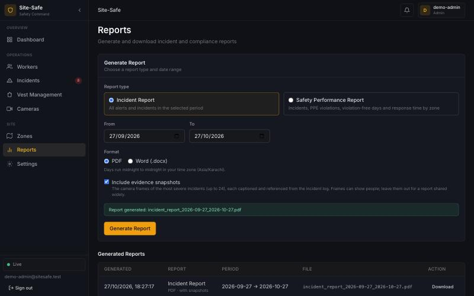

**Reports** (Safety Officers and Admins) produces a Word or PDF document for whole days in your time zone:

- **Incident Report:** every incident in the period, counts by type and severity, time to resolve, and the incident log.
- **Safety Performance Report:** incidents, PPE violations, days without a recorded PPE violation, and time to resolve, by zone; incidents per identified worker; attendance and idle time. It gives no compliance percentage, because the system counts violations it detects, not compliant observations.

**Include evidence snapshots** adds the camera frames of the most severe incidents: up to 24 in the incident report, numbered E1, E2, … and pointed to from the log's **Figure** column, or up to two per zone in the safety report. Each is captioned with the alert, time, camera, worker and model. The report also says how many incidents had no snapshot. Snapshots can show people: leave them out for a report that will be shared widely. **Generated Reports** keeps every report with whether it has snapshots.

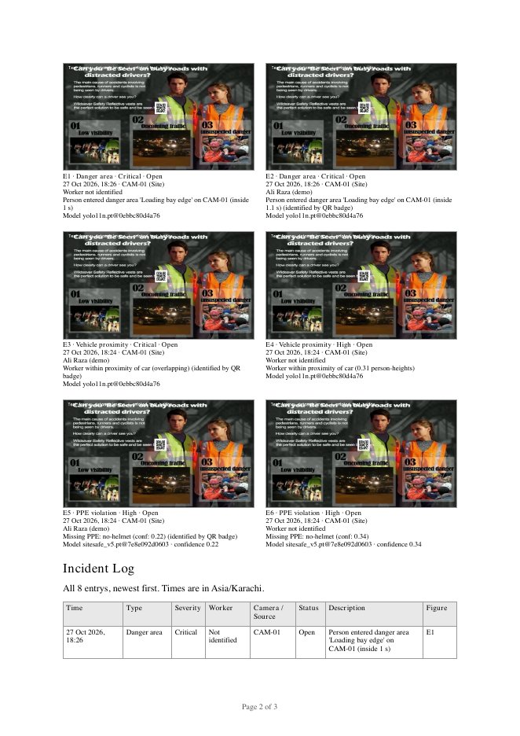

## 8. Settings

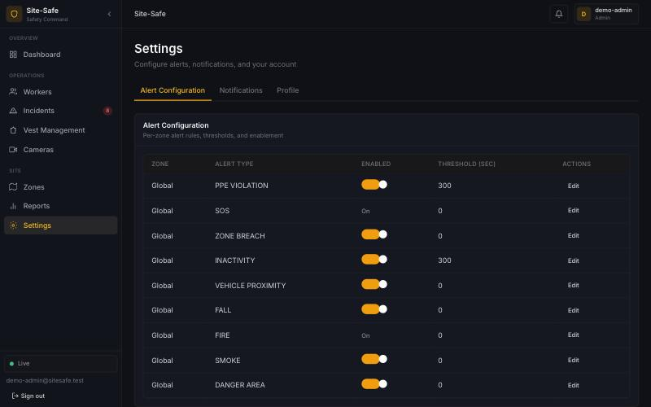

- **Alert Configuration** (Admins change, others read): switch an alert type on or off, and set its threshold in seconds, such as the inactivity time. SOS, fire and gas cannot be switched off and show as **Always on**. A camera picks up changes within 15 s.
- **Notifications:** push notifications to your phone and email notifications, for you.
- **Profile:** your name and email, and changing your password.

## 9. Mobile app

The mobile app is for supervisors on site. Sign in with the server address, your email and password. It has five tabs:

| Alerts | Map | Camera | Alert detail |
|---|---|---|---|
| 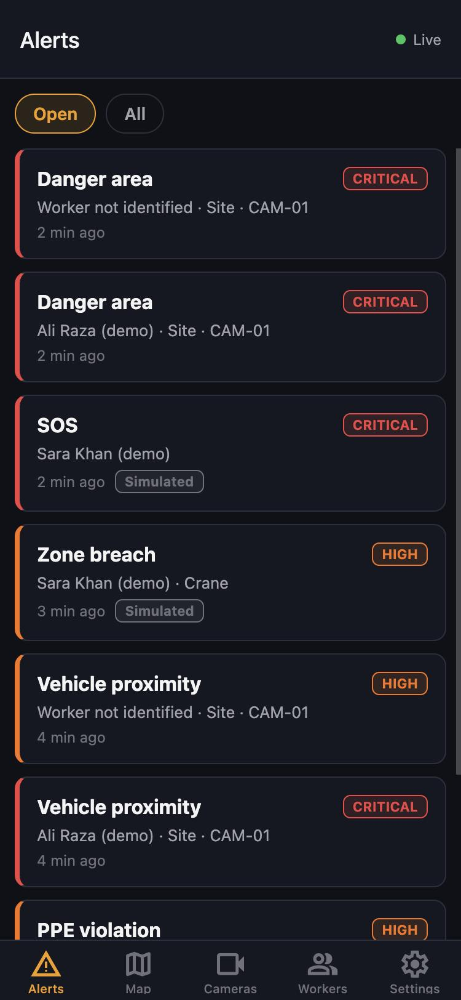 | 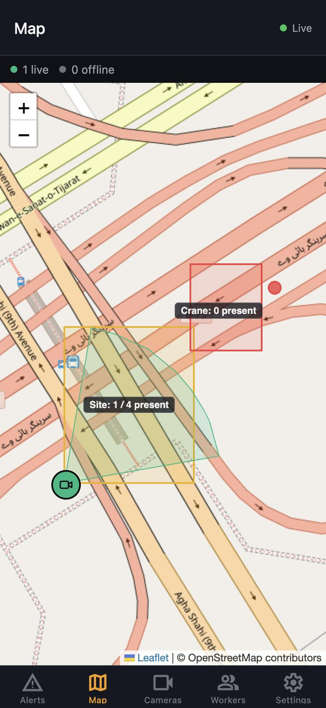 | 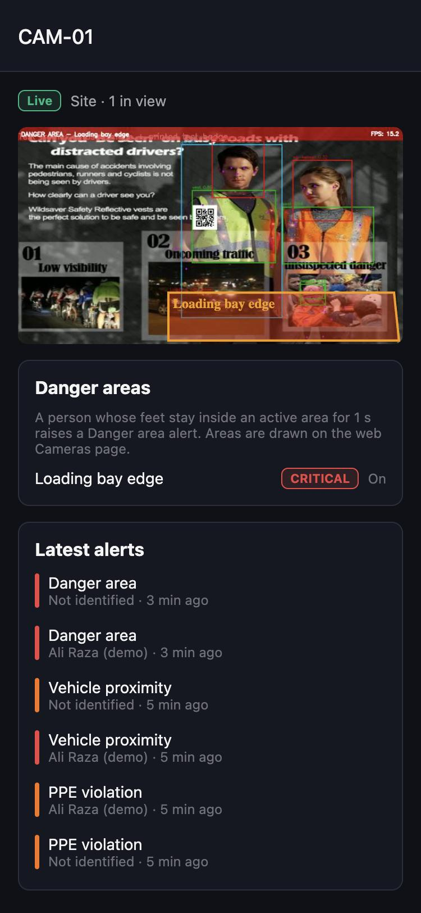 | 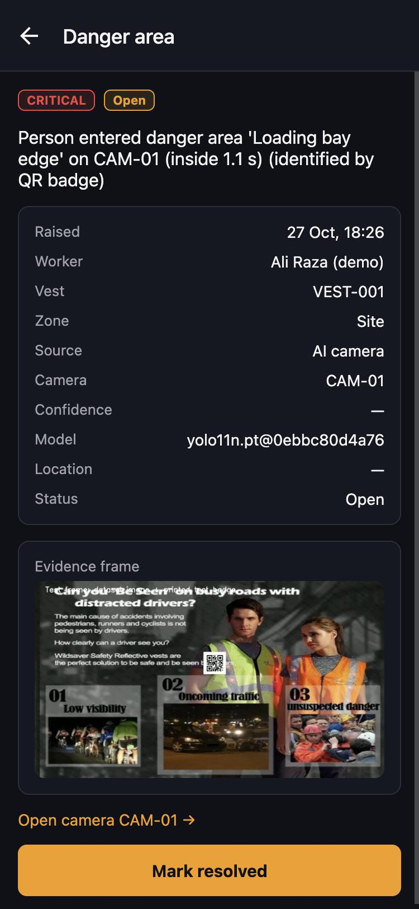 |

- **Alerts:** open or all alerts, live; simulated ones are labelled. Open one for its details, evidence frame and model, **Open camera**, and **Mark resolved**.
- **Map:** the site map as on the dashboard. Tap a camera to open it.
- **Cameras:** each camera's status, people in view and alerts. A camera's screen shows its live picture with its danger areas outlined (Safety Officers and Admins), its areas (Admins can switch one off) and its latest alerts.
- **Workers:** presence and location.
- **Settings:** your account, push alerts on or off, and sign out.

With a development build, critical alerts also arrive as push notifications; tapping one opens the alert. The green **Live** dot shows the app is receiving alerts as they happen.

## 10. Privacy and records

- **Live pictures** are relayed and kept only as the latest frame for 30 s; nothing is recorded.
- **Evidence frames** are stored with the alert and removed after the retention period (30 days by default) by the daily clean-up job (`purge_alert_snapshots`). A report made later says which incidents no longer have one.
- **QR badges** carry a random code, not a name.
- **Simulated** data (from the Event Simulator or the vest simulator) is labelled and never counted in report figures.
- Only Safety Officers and Admins see camera pictures.

## 11. Troubleshooting

| Problem | What to check |
|---|---|
| A camera shows offline | Is its pipeline running and on the network? It needs its device key and the right camera ID. Offline means no picture for 5 s. |
| Alerts say "Worker not identified" | Is the badge printed large enough (8 cm or more), facing the camera, unobstructed, and not reissued since? |
| A danger area raises nothing | Is it switched on? Is it drawn where feet are? Has 15 s passed since it was saved? |
| The map is blank | The base map needs internet access. Zones, vests and cameras still need positions: a camera-only zone has no boundary to draw. |
| A report has fewer snapshots than incidents | Snapshots are switched off for some cameras, or older than the retention period; the report states how many. |
| No push notifications | Push needs a development build of the app with Firebase set up and Push notifications on in Settings. The app still shows alerts live while open. |
| "Live" shows Offline | The app or dashboard reconnects by itself; check the network if it stays offline. |
